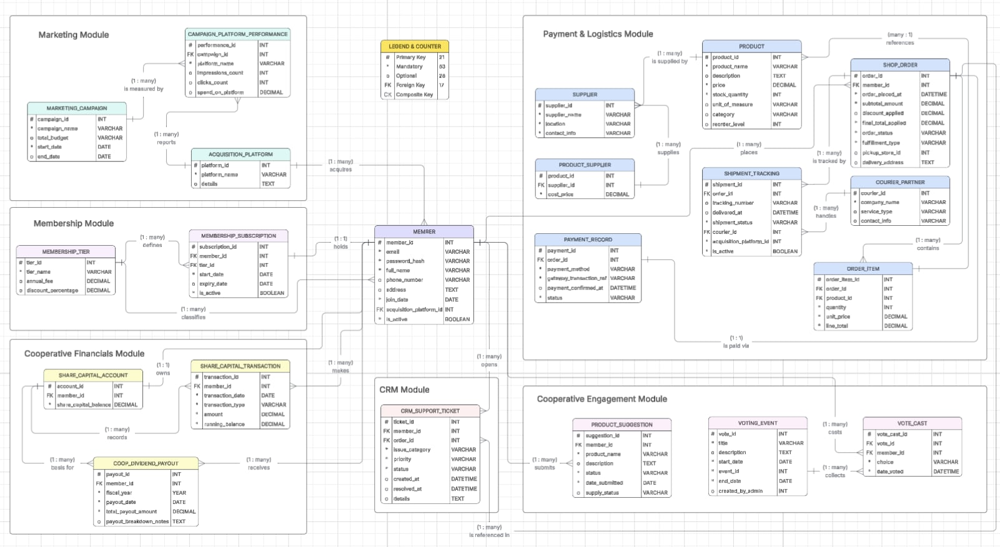
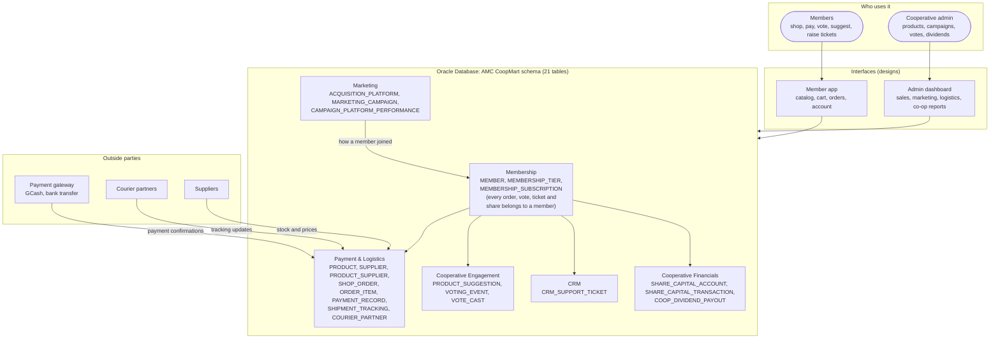
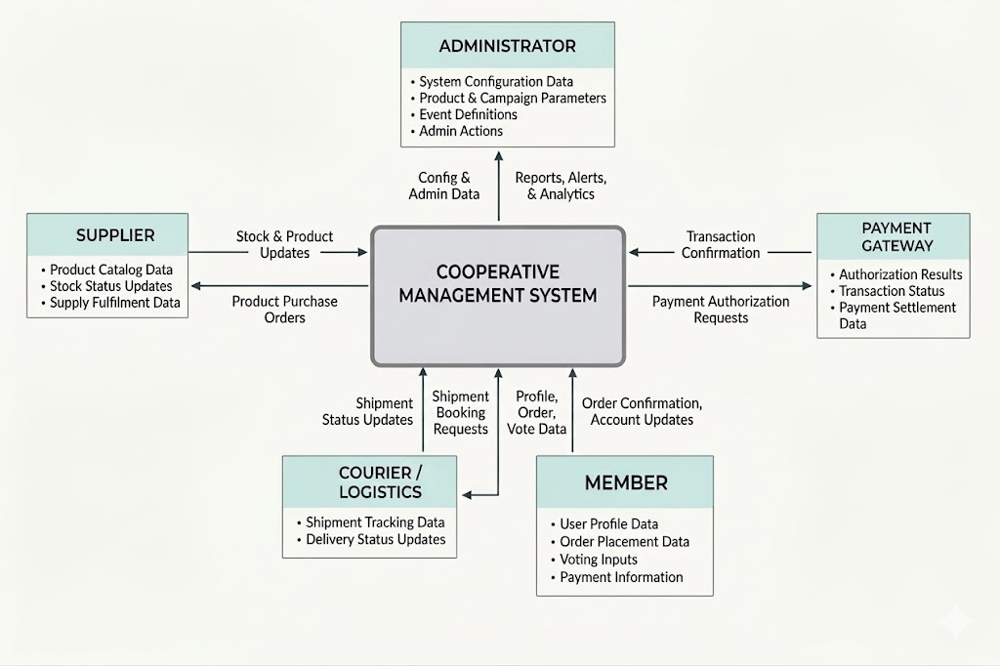
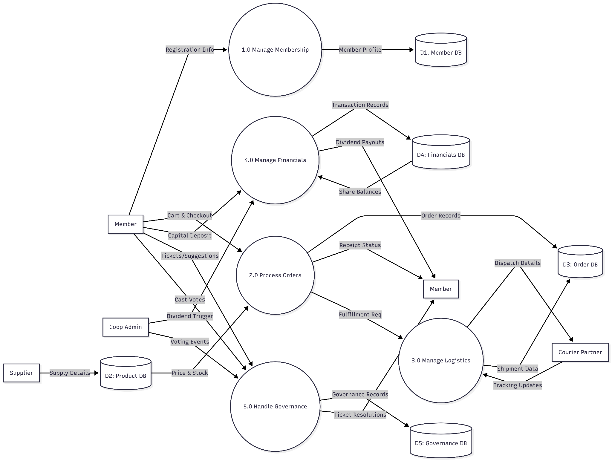

# AMC CoopMart: A Membership-Based Digital Grocery Cooperative Database

**A 21-table Oracle SQL database for a community grocery cooperative: members and their plans, products and suppliers, orders, payments and deliveries, member votes and product ideas, support tickets, share capital and dividends.**

Group final project for **ITE 014 Information Management** at the Technological Institute of the Philippines, Quezon City (section DS22S1, April 2026). The design is based on a real cooperative store in Quezon City.

| At a glance | |
|---|---|
| Database | Oracle Database 19c (also runs on Oracle 23ai Free) |
| Size | 21 tables in 6 modules, 20 foreign keys |
| Scripts | Schema, fictional sample data, 10 analysis queries, data manipulation, schema changes, extra schema objects |
| Design documents | ER diagram, context diagram, data flow diagram, data dictionary |



## Contents

- [In plain words](#in-plain-words)
- [Problem statement](#problem-statement)
- [Objectives](#objectives)
- [System architecture](#system-architecture)
- [The six modules](#the-six-modules)
- [Business rules](#business-rules)
- [Repository structure](#repository-structure)
- [Run it](#run-it)
- [What the queries answer](#what-the-queries-answer)
- [About the data](#about-the-data)
- [Changes from the original documentation](#changes-from-the-original-documentation)
- [Future enhancements](#future-enhancements)
- [Glossary](#glossary)
- [Team](#team)

---

## In plain words

A cooperative store is owned by its members: they buy shares, shop at member prices, vote on decisions and receive part of the profit. A small cooperative grocery in Quezon City kept these records manually and in separate files, which made it hard to keep track of who ordered what, whether a payment was verified, where a delivery was, and how much each member should receive as a dividend.

We designed one database that keeps all of this in one place. It has 21 linked tables: for example, an order belongs to a member, each item in the order points to a product, and each delivery points to an order and a courier. The links stop mistakes such as an order for a member who does not exist. This repository contains the scripts that build the database, a made-up sample dataset, and the questions we answered with SQL.

## Problem statement

Community-based grocery cooperatives often rely on manual or fragmented systems for member records, inventory, orders, payments and deliveries. That leads to inconsistent data, slow transactions and records that are hard to track. Without a central, integrated database, the cooperative also struggles to distribute profit fairly and to keep members engaged, which weakens transparency and decision-making.

## Objectives

**General:** design and implement AMC CoopMart, a database-driven cooperative grocery system in Oracle 19c SQL that manages members, inventory, transactions and cooperative services, with better transparency, efficiency and member engagement.

**Specific:**

1. Record accurate member information and share capital contributions.
2. Monitor stock levels, prices and product details.
3. Let members place and track orders.
4. Support verified digital payments such as GCash and bank transfer.
5. Offer pickup or delivery with tracking.
6. Calculate and allocate dividends and other member benefits.
7. Let members vote, give feedback and suggest products.
8. Protect data integrity and consistency through relational design.

## System architecture

AMC CoopMart is a database design: one Oracle schema that the cooperative's member app, admin dashboard and staff tools would all read and write. The project documentation includes screen designs for those interfaces; this repository holds the database layer.



**How the tables are built.** Every foreign key must point at a table that already exists, so the schema is created in four phases:

| Phase | Tables | Why this order |
|---|---|---|
| 1. Independent | MEMBERSHIP_TIER, ACQUISITION_PLATFORM, MARKETING_CAMPAIGN, PRODUCT, SUPPLIER, COURIER_PARTNER, VOTING_EVENT | No foreign keys |
| 2. First level | MEMBER, CAMPAIGN_PLATFORM_PERFORMANCE, PRODUCT_SUPPLIER | Depend only on phase 1 |
| 3. Second level | MEMBERSHIP_SUBSCRIPTION, SHOP_ORDER, PRODUCT_SUGGESTION, VOTE_CAST, SHARE_CAPITAL_ACCOUNT, SHARE_CAPITAL_TRANSACTION, COOP_DIVIDEND_PAYOUT | Mostly records owned by a member |
| 4. Final | ORDER_ITEM, PAYMENT_RECORD, SHIPMENT_TRACKING, CRM_SUPPORT_TICKET | Depend on orders, products and couriers |

Data is loaded in the same order, parents before children.

**One order, end to end:** a member places a `SHOP_ORDER`; each product in the cart becomes an `ORDER_ITEM`; the payment gateway's confirmation is stored in `PAYMENT_RECORD`; if the member chose delivery, a courier's progress is tracked in `SHIPMENT_TRACKING`; any problem becomes a `CRM_SUPPORT_TICKET` linked to the member and the order.

<p>
  
  
</p>

The **context diagram** (left) shows what flows between the system and the administrator, suppliers, couriers, the payment gateway and members. The **data flow diagram** (right) breaks the system into five processes (manage membership, process orders, manage logistics, manage financials, handle governance) and the data stores they use.

## The six modules

| Module | Tables | What it covers |
|---|---|---|
| Membership | MEMBER, MEMBERSHIP_TIER, MEMBERSHIP_SUBSCRIPTION | Registration, Bronze/Silver/Gold plans and their discounts, active and expired plans |
| Marketing | ACQUISITION_PLATFORM, MARKETING_CAMPAIGN, CAMPAIGN_PLATFORM_PERFORMANCE | How members found the co-op; campaign budgets; impressions, clicks and spend per platform |
| Payment & Logistics | PRODUCT, SUPPLIER, PRODUCT_SUPPLIER, SHOP_ORDER, ORDER_ITEM, PAYMENT_RECORD, SHIPMENT_TRACKING, COURIER_PARTNER | Inventory and reorder levels, supplier costs, orders with member discounts, payment verification, pickup or delivery |
| Cooperative Engagement | PRODUCT_SUGGESTION, VOTING_EVENT, VOTE_CAST | Member product ideas and their sourcing status; votes and ballots |
| CRM | CRM_SUPPORT_TICKET | Issues by category and priority, linked to a member and optionally an order |
| Cooperative Financials | SHARE_CAPITAL_ACCOUNT, SHARE_CAPITAL_TRANSACTION, COOP_DIVIDEND_PAYOUT | Share capital balances, deposits with running balances, yearly dividends |

Every column, type and rule is listed in the [data dictionary](docs/data-dictionary.md).

## Business rules

1. **Membership:** only registered members use the system, and they contribute share capital for full privileges.
2. **Pricing and purchasing:** member-exclusive prices; every purchase is recorded.
3. **Payment:** digital payments (GCash, bank transfer) are verified before an order is processed.
4. **Fulfillment:** members choose pickup or delivery and can follow its status.
5. **Profit distribution:** dividends and benefits follow participation, share capital and recorded transactions.
6. **Data privacy:** member and transaction data are protected from unauthorized access or changes.
7. **Engagement:** members vote, give feedback and suggest products; decisions reflect the collective interest.

## Repository structure

```text
├── sql/
│   ├── 00_drop_tables.sql         removes every table, to start over
│   ├── 01_create_tables.sql       the 21 tables, in four dependency phases
│   ├── 02_sample_data.sql         fictional sample data (309 rows)
│   ├── 03_analysis_queries.sql    problems A to I: filtering, functions, joins, subqueries, set operators
│   ├── 04_data_manipulation.sql   problem J: INSERT, UPDATE, SELECT, DELETE
│   ├── 05_schema_changes.sql      problem K: CREATE, ALTER, RENAME, DROP
│   └── 06_schema_objects.sql      problem L: view, sequence, index, synonym, audit table
├── docs/
│   ├── erd.jpg                    entity relationship diagram
│   ├── context-diagram.png
│   ├── data-flow-diagram.png
│   └── data-dictionary.md         every table and column
└── README.md
```

## Run it

You need an Oracle database. Any of these works:

| Option | Setup |
|---|---|
| **Oracle Live SQL** (no install) | Sign in free at [livesql.oracle.com](https://livesql.oracle.com), open a SQL worksheet, paste each script and run it |
| **Docker** | `docker run -d --name amc-oracle -p 1521:1521 -e ORACLE_PASSWORD=ChangeMe123 gvenzl/oracle-free:23-slim`, then connect as `system` to `localhost:1521/FREEPDB1` |
| **Oracle SQL Developer or VS Code** | Connect to any Oracle 19c+ database you have, open each file and run it as a script (F5) |

Then run the scripts in order:

1. `sql/01_create_tables.sql`: creates the 21 tables.
2. `sql/02_sample_data.sql`: loads the sample data and commits.
3. `sql/03_analysis_queries.sql`: runs the ten analysis queries (read-only).
4. `sql/04_data_manipulation.sql`, `05_schema_changes.sql` and `06_schema_objects.sql`: the remaining exercises. The first two undo their own changes.

To start again, run `sql/00_drop_tables.sql`.

**Checked:** the schema, sample data, analysis queries and the data manipulation script were run end to end with foreign keys enforced: all 21 tables load, there are no foreign key violations, and every query returns results. Problems K and L use Oracle-only statements (`RENAME`, `CREATE SYNONYM`), so run them on Oracle.

## What the queries answer

| # | Business question | SQL skills |
|---|---|---|
| A | Which active members joined in 2025 through the website? | `WHERE`, comparison and logical conditions, `ORDER BY`, join |
| B | A clean member report: uppercase names, masked emails, a default for missing phones, formatted dates | `UPPER`, `SUBSTR`, `NVL`, `ROUND`, `TO_CHAR` |
| C | 2025 orders above a threshold written as text | `TO_CHAR`, `TO_NUMBER`, `TO_DATE` |
| D | Which product is the most expensive? | `MAX` in a subquery |
| E | How many orders, and how much money, per order status? | `COUNT`, `SUM`, `GROUP BY` |
| F | Which member bought which product? | Oracle join syntax and ANSI/SQL:1999 joins |
| G | Who has more share capital than the average member? | Single-row subquery with `AVG` |
| H | Which products appear in orders that were not cancelled? | Nested multiple-row subqueries with `IN` |
| I | One contact list of members and suppliers, for emergency alerts | `UNION` |
| J | Register a member, log their product suggestion, update it, then clean up | `INSERT`, `UPDATE`, `SELECT`, `DELETE` |
| K | Add pickup stores linked to orders, rename them, then remove them | `CREATE`, `ALTER`, `RENAME`, `DROP` |
| L | Reporting helpers: an order audit log, a spending view, a sequence, an index and a synonym | `CREATE VIEW`, `SEQUENCE`, `INDEX`, `SYNONYM` |

## About the data

The project was built with operational data that AMC Cooperative Store released to the team **for academic use only, without permission to publish it**. That dataset, the release certificate and the full documentation that contains them are therefore not in this repository.

`sql/02_sample_data.sql` is a **fictional** dataset written for this repository so anyone can run the scripts: 16 members, 14 products, 5 suppliers, 3 couriers, 24 orders with 67 order lines, payments, deliveries, votes, suggestions, support tickets, share capital and dividends. All names, emails (`@example.com`), phone numbers (`0900-000-xxxx`), prices and amounts are made up.

## Changes from the original documentation

| Change | Reason |
|---|---|
| `MEMBER` has an `acquisition_details` column | The data dictionary and the original INSERT statements use it, but the original CREATE TABLE left it out |
| `COURIER_PARTNER` is created before `SHIPMENT_TRACKING` | `SHIPMENT_TRACKING` references it (the documentation's phase list already had this order) |
| `MEMBERSHIP_SUBSCRIPTION.status` is filled in the sample data | It is required (`NOT NULL`) |
| Problem J also deletes the test member | The original cleanup removed the suggestion but left member 135 behind |

## Future enhancements

- A web portal and mobile app for members on top of this schema
- Real-time dashboards for sales, logistics and member activity
- Automated dividend computation from share capital and purchases
- Product recommendations from purchase history and suggestions
- Cloud deployment of the database

## Glossary

| Term | Meaning |
|---|---|
| Cooperative | A business owned and run by its members, who share its profit |
| Share capital | Money members invest in the cooperative; it decides their share of dividends |
| Dividend | A member's share of the cooperative's yearly profit |
| Table, row, column | A table holds one kind of record (for example orders); each row is one record; each column is one detail |
| Primary key (PK) | The column that uniquely identifies each row, such as `order_id` |
| Foreign key (FK) | A column that points to a row in another table, such as an order's `member_id`; the database refuses links to rows that do not exist |
| Referential integrity | The guarantee that every foreign key points to a real row |
| Normalization | Storing each fact once, in its own table, to avoid duplicates and contradictions |
| DDL / DML | Data Definition Language builds and changes tables; Data Manipulation Language adds, changes and reads rows |
| ERD | Entity relationship diagram: a picture of the tables and their links |

## Team

Technological Institute of the Philippines, Quezon City. Instructor: Dr. Rosmina Joy Cabauatan.

| Member | Responsibilities |
|---|---|
| **James Andre L. Kalaw** | Team leader and database manager: database design, the ERD, creating and populating the tables |
| Juliana Ysabel D.C. Detera | Database schema, data gathering |
| Josh Andrei A. Ituralde | Data verification, data flow diagram, compilation of errors |
| Mia Ysabel R. Semilla | Main GUI, documentation, database verification |
| Joseph Jennard Palijado | Context diagram, documentation, database table structure |
